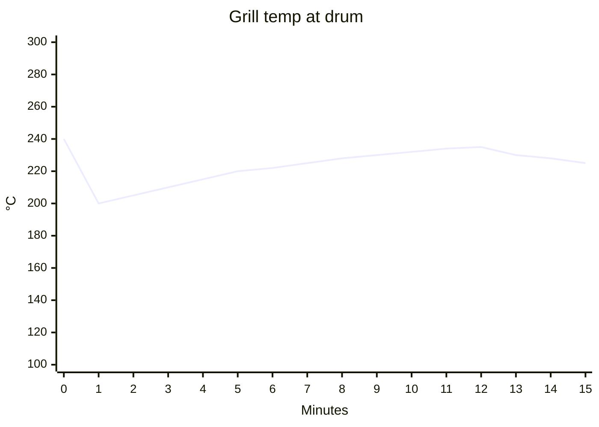

# Roast {{title}}

> Fill the frontmatter properties as you go — they feed the [[Roast Log]] table.
> Times as `mm:ss` from charge. Score 1–10 after tasting.

## 1. Plan (before lighting the grill)
- **Bean / lot:** 
- **Goal for this roast:** (e.g. repeat baseline / test +30 s development)
- **Variable changed vs. previous roast:** 
- **Previous roast this compares to:** [[ ]]
- **Planned drop:** first crack + ___ min

## 2. Conditions
| Item | Value |
|---|---|
| Outside temperature (°C) | |
| Wind / weather | |
| Fuel / burner setting | |
| Drum fill (g / approx. volume) | |
| Preheat temperature at drum (°C) | |
| Preheat duration (min) | |

## 3. Timeline log
| Time (mm:ss) | Grill temp at drum (°C) | Burner / lid change | Observation (colour, smell, sound) |
|---|---|---|---|
| 00:00 | | Charge | |
| 01:00 | | | |
| 02:00 | | | |
| 03:00 | | | |
| 04:00 | | | |
| 05:00 | | | |
| 06:00 | | | |
| 07:00 | | | |
| 08:00 | | | |
| 09:00 | | | |
| 10:00 | | | |
| 11:00 | | | |
| 12:00 | | | |
| 13:00 | | | |
| 14:00 | | | |
| 15:00 | | | |
| | | **Yellow** | |
| | | **First crack start** | |
| | | **First crack end** | |
| | | **Second crack start** (if any) | |
| | | **Drop** | |

## 4. Result
| Measure | Value |
|---|---|
| Green weight (g) | |
| Roasted weight (g) | |
| Weight loss % = (green − roasted) / green × 100 | |
| Development time (drop − first crack) | |
| DTR % = development / drop time × 100 | |
| Cooling time to cool-to-touch | |
| IR surface temp at drop (°C) | |
| Colour / evenness | |
| Visible defects (scorching, tipping, pale beans) | |
| Roast level (light / medium / medium-dark / dark) | |

### Result photo
Take the photo on a white plate, daylight or the same lamp every time, same distance. Put a few green beans next to the roasted ones for reference.
Save to `Areas/Coffee Roasting/Photos/` as `{{date:YYYY-MM-DD}}-roast-NNN.jpg`, then fix the file name below and in the `photo` property.

![[{{date:YYYY-MM-DD}}-roast-NNN.jpg|500]]

### Temperature curve (optional)
Fill in the grill temperatures from the timeline to get a chart (Obsidian Mermaid).

*(Values above are placeholders — replace them with your own readings.)*

## 5. Tasting
| | Day ___ (rest) | Day ___ (rest) |
|---|---|---|
| Brew method / recipe | | |
| Aroma | | |
| Acidity (1–5) | | |
| Sweetness (1–5) | | |
| Body (1–5) | | |
| Bitterness (1–5) | | |
| Defects (grassy, bready, ashy, baked, smoky) | | |
| Notes | | |
| Score (1–10) | | |

Espresso result (link to dial-in): [[Areas/Espresso/README|Espresso]]

## 6. Conclusion and next roast
- **What the change did:** 
- **Keep / reject:** 
- **Next roast — change only this:** 
